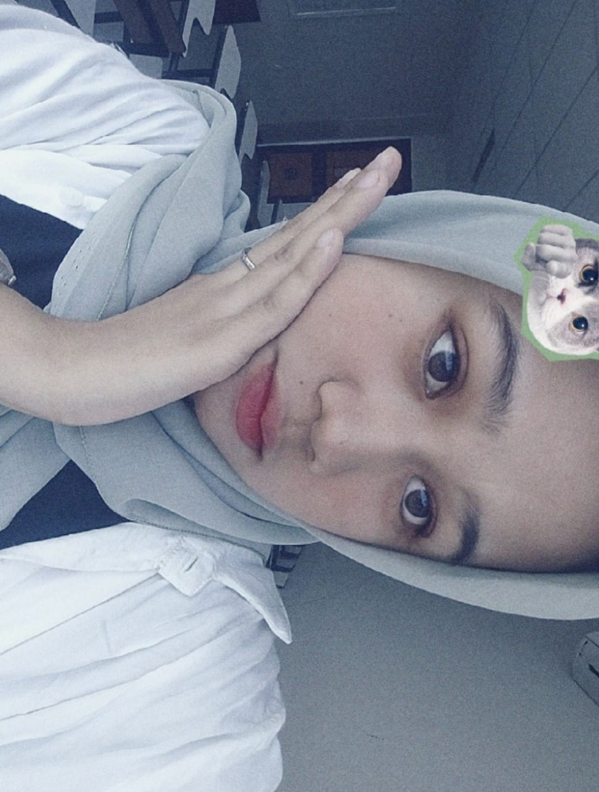

# Website Ucapan Ulang Tahun (Tema Kuning & Kucing)

Paket website ucapan ulang tahun siap pakai (`index.html`).

## Cara Memasukkan Foto Pacar
1. Simpan file foto pacar Anda ke dalam folder yang sama dengan `index.html` (misalnya `foto1.jpg`, `foto2.jpg`, `foto3.jpg`, `foto4.jpg`).
2. Buka `index.html` menggunakan editor teks (VS Code / Notepad).
3. Cari komentar `[PENANDA FOTO 1]` hingga `[PENANDA FOTO 4]`, lalu ganti blok `<div class="photo-placeholder-card">...</div>` dengan tag gambar:
   ```html
   
   ```

## Cara Mengunggah ke GitHub Pages
1. Upload `index.html` beserta file foto ke repositori GitHub Anda.
2. Masuk ke **Settings > Pages**, pilih Branch **main** dan folder **/ (root)**, lalu klik **Save**.
3. Website siap dibagikan!
